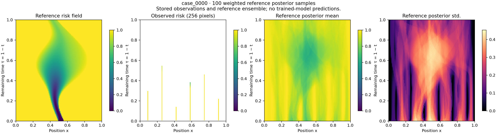
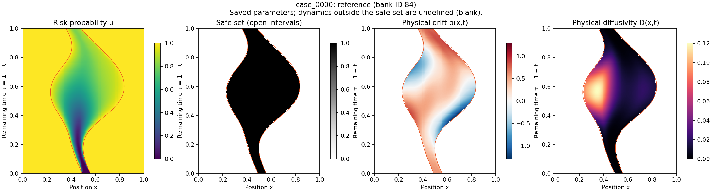

# Stochastic Risk Quantification

Generate, load, visualize, and analyze first-exit **risk probability** fields for
a one-dimensional stochastic process with hidden, moving safe sets.



**Posterior inference — case_0000.** The mean and population standard deviation
use the saved normalized weights of all 100 reference posterior samples. The
reference field, observations, and mean share a 0–1 color scale; unobserved pixels
are blank. Standard deviation uses its own color scale. The vertical axis is
remaining time, τ = 1 − t.

## Physical model

\[
dX_t=b(X_t,t)\,dt+\sqrt{2D(X_t,t)}\,dW_t.
\]

The stored field is `u(tau,x)`: the probability of leaving the safe set before
deadline 1, starting at position x and chronological time `t=1-tau`. The field has
one physical channel. It is not a trajectory, safety probability, or two-dimensional
spatial process. Safety probability is `1-u`.



**Physical model — the same case_0000.** Safe-set boundaries and dynamics are
evaluated directly from the saved parameters. Orange curves mark the moving safe
boundaries; drift and diffusivity are blank outside the safe set. No PDE solve is
needed to create either figure.

## Install

Python 3.13 is the tested reproduction environment. From this directory:

```bash
python -m venv .venv
source .venv/bin/activate
python -m pip install -r requirements-lock.txt
python -m pip install --no-deps .
```

`requirements-lock.txt` records the exact numerical/library versions used for the
dataset. `pyproject.toml` also declares supported dependency ranges; use the pinned
environment for regeneration. The code uses CPU computation with Numba. A GPU is
not required. Initial compilation adds startup time.

## Use the full dataset

The benchmark directory contains:

| Component | Content |
|---|---|
| `PDEFieldDataset_hf/RiskQuantification/` | 100,000 training fields in one unsplit HF Dataset |
| `PosteriorDataset_hf/RiskQuantification/` | 100 cases: 10 validation and 90 test, with 100 samples each |
| `parameters/training/` | Explicit dynamics and safe-set parameters for training fields |
| `parameters/cases/` | Reference and ordered posterior parameters for every case |
| `manifest.json` | Configuration, sample identities, streams, and relative file mappings |

The separate 1M candidate pool stores every generated field and its parameters,
including candidates rejected by all cases. The 100k training fields come from an
independent stream; they are not selected from this candidate pool. Large datasets
are distributed separately from this code repository.

Set paths to the datasets you received:

```bash
export RISK_DATA=/path/to/risk_quantification_full_dataset
export RISK_POOL=/path/to/candidate_pool_1m
export RISK_OUTPUT=/path/to/analysis_output
```

```python
from datasets import load_from_disk
from dataset_io import load_sample, read_observations

training = load_from_disk('/path/to/risk_quantification_full_dataset/PDEFieldDataset_hf/RiskQuantification')
posterior = load_from_disk('/path/to/risk_quantification_full_dataset/PosteriorDataset_hf/RiskQuantification')
# training: u, metadata
# posterior: u_ref, posterior_samples_u, posterior_weights, metadata
u, params, cfg, label = load_sample('/path/to/risk_quantification_full_dataset', case_id='case_0000')
observations = read_observations('/path/to/risk_quantification_full_dataset', 'case_0000')
```

`read_observations` returns only observation values, coordinates, mask, and grids.
Full fields and dynamics/safe-set parameters are targets for evaluation, not
conditioning inputs. See [the format documentation](docs/format.md).

## Visualization

These commands use saved fields, observations, weights, and parameters; they do not
draw random samples or solve a PDE.

```bash
risk-visualize --dataset "$RISK_DATA" --view inference --case case_0000 --output "$RISK_OUTPUT/inference.png"
risk-visualize --dataset "$RISK_DATA" --case case_0000 --output "$RISK_OUTPUT/reference.png"
risk-visualize --dataset "$RISK_DATA" --collection posterior --case case_0000 --sample-index 0 --output "$RISK_OUTPUT/posterior.png"
risk-visualize --dataset "$RISK_DATA" --collection training --sample-id 100 --output "$RISK_OUTPUT/training.png"
risk-visualize --dataset "$RISK_POOL" --collection candidate --sample-id 100 --output "$RISK_OUTPUT/candidate.png"
```

The inference view shows the reference field, observations, and weighted reference
posterior mean/std. The default physical view shows risk, safe-set membership and
boundaries, drift, and diffusivity. Both use remaining time on the vertical axis.
The two README figures can be reproduced with `case_0000` using these commands.

## Analysis

```bash
risk-analyze summary --dataset "$RISK_DATA" --output "$RISK_OUTPUT/summary"
```

This computes weighted posterior mean/std arrays, effective sample sizes, exact
field overlap between cases, and an overlap plot. Outputs are written only to the
chosen directory; they are not bundled in this repository.

To evaluate prediction ensembles, put one `case_XXXX.npz` file per case in a
directory. Each contains `u` with shape `[samples,128,128]`, and optionally normalized
or unnormalized nonnegative `weights`. Omitted weights mean uniform weighting.

```bash
risk-analyze evaluate --dataset "$RISK_DATA" --predictions /path/to/predictions --split test --output "$RISK_OUTPUT/scores.json"
```

Metrics are weighted mean/std relative L2, MMD, sliced Wasserstein distance, and
the geometric mean spectral discrepancy. SWD uses shared training-field
normalization and fixed random directions. The metric implementations are provided
in `src/reference_metrics.py` and run through this package’s `risk-analyze` command.
Prediction scores are computed per case and averaged over the selected split.

## Generate the full dataset

The supplied [full configuration](configs/full.json) records the exact counts,
streams, frozen reference IDs, observation design, solver settings, and retention
seed for the released dataset.

```bash
risk-generate --config configs/full.json --output /path/to/generated_data --threads 12
```

The workflow generates `references/`, `training_pool/`, `candidate_pool/`, and
`benchmark/`. Parameters are sampled once, passed to the fine solver, and saved
with the resulting fields. The benchmark is exported in the single-channel
Hugging Face format described above.
Allow substantial CPU time and approximately 80 GiB of free working storage.

Stages can be run individually with `--stage references`, `training`, `candidates`,
or `export`. Repeat the same command to resume completed batches. Configuration
changes require a new output location. The exporter refuses to replace cases or
pad ensembles if any case has fewer than 100 accepted samples. Writes are atomic,
and completed artifacts are checksummed. After an abrupt process kill, inspect
running processes before removing a stale generation lock.

The published configuration already contains the 100 frozen case identities.
To repeat their preceding discovery stage:

```bash
risk-discover --config configs/full.json --output /path/to/discovery --threads 12
risk-generate --config /path/to/discovery/selected_config.json --output /path/to/generated_data --threads 12
```

Discovery uses 7,000 reference-bank fields and up to 22,000 independent candidates,
selecting matchable observation problems with balanced K=6..12 quotas. The cases
are frozen before the independent 1M confirmation pool. This selection favors
matchability and is not representative sampling of all possible observations.
Discovering a different set after changing the configuration creates a different
benchmark, not a replacement version of the existing data.

## Matching and saved parameters

Each case has 256 observed pixels, excluding tau=0, arranged in unequal positive-time
prefixes on K spatial columns. A candidate is accepted when observed RMSE is at
most 0.05. The Gaussian weighting scale is `sigma=0.05/3`; this is an RMSE kernel,
not a claim that each pixel has independent Gaussian noise of that magnitude.
After scanning the complete pool, select 100 accepted sample IDs uniformly without
replacement, compute normalized Gaussian weights, and order by descending weight
(ties by candidate ID). Reuse across cases is permitted.

Numerical solver and prior modules are preserved from the generation implementation.
Stored parameters allow evaluation of the physical dynamics and safe sets without
reconstructing the random draws.
